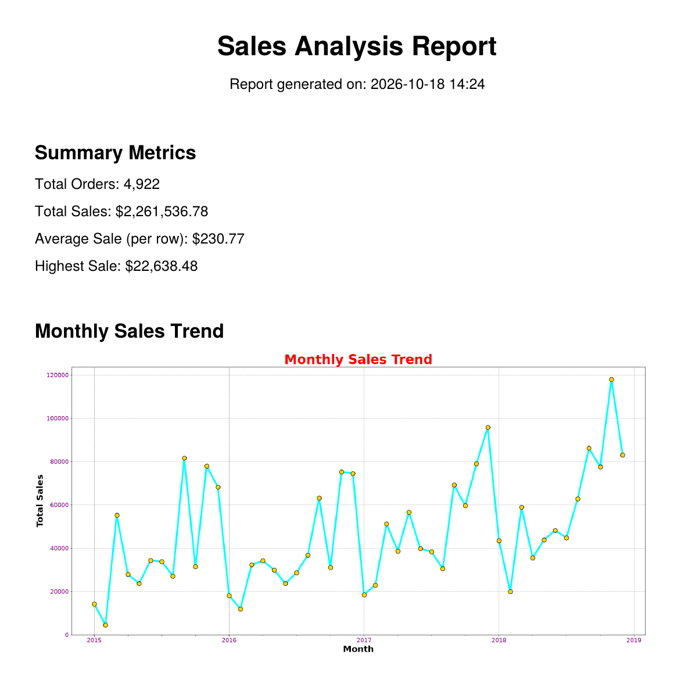
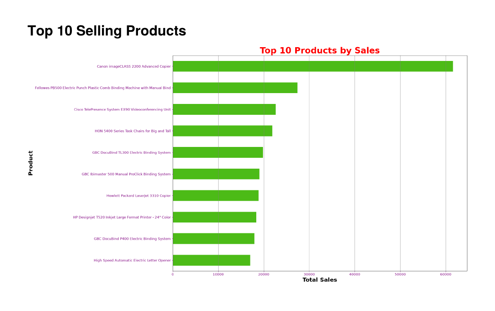

# Smart Sales Data Analyzer

## Overview

A Python pipeline that turns raw sales data into a professional PDF report — 
automatically.

Point it at any sales CSV — telling it which columns hold the date, amount,
product, region and category — and it will:
- Clean and validate the data
- Identify trends by month, region, and category
- Generate 4 charts (monthly trend, category breakdown, regional distribution, top products)
- Compile everything into a timestamped, multi-page PDF report

Built with pandas, matplotlib, and FPDF2. No manual work required after setup.

---

## Features

- Works on your own CSV: column names, date format, input and output paths are all command-line options
- Data cleaning — removes duplicates and rows missing a value the analysis needs (a blank, unrelated column like Postal Code doesn't throw a sale away)
- Clear error if a column is missing, listing the columns the file actually has
- Sales trend analysis
- Automatic chart generation
- Summary metrics calculation
- Multi-page PDF report generation

---

## Tools & Libraries

- Python 3.10+
- pandas
- matplotlib
- fpdf2

---

## Project Structure

```
Smart-Data-Analyzer/
│
├── charts/              # Generated charts
│   ├── monthly_sales.png
│   ├── sales_by_category.png
│   ├── sales_by_region.png
│   └── top_10_products.png
│
├── data/
│   └── sales_data.csv
│
├── output/
│   └── sales_report.pdf
│
├── screenshots/
│   ├── report_preview_1.png
│   └── report_preview_2.png
│
├── main.py              # entry point: options, cleaning, analysis, charts
├── generate_report.py   # build_report(): turns summary + charts into the PDF
├── .gitignore
├── LICENSE
├── requirements.txt
└── README.md
```

---

## How It Works

### 1. Data Processing

`main.py` reads the dataset and performs:

- Column check (stops with a helpful message if a column is missing)
- Data cleaning — duplicates, and rows missing a date, amount, product, region or category
- Date and amount conversion (unreadable values are dropped, not crashed on)
- Grouping and aggregation

### 2. Visualization

Charts are generated using **matplotlib**:

- Monthly sales trend
- Sales by category
- Sales by region
- Top selling products

The charts are automatically saved in the `charts/` folder.

### 3. Report Generation

`generate_report.py` creates a **multi-page PDF report** using **FPDF2**;
`main.py` calls it automatically at the end of the run.

The report includes:

- Report title
- Generation timestamp
- Summary statistics
- Visual charts

---

## 🚀 How to Run

### 1. Install dependencies
```bash
pip install -r requirements.txt
```

### 2. Run the full pipeline
```bash
python main.py
```

This runs the analysis, saves the charts to `charts/`, and builds the PDF
report at `output/sales_report.pdf`.

### 3. Use your own CSV
```bash
python main.py --input my_sales.csv \
    --date-col "Date" --sales-col "Revenue" --product-col "Item" \
    --region-col "Area" --category-col "Type" --order-col "Invoice No"
```

- Pass `--region-col ""` or `--category-col ""` to skip a chart your data has no column for
- Pass `--order-col ""` to count rows instead of unique orders
- Add `--month-first` if your dates are MM/DD/YYYY (the default is DD/MM/YYYY)
- `--charts-dir` and `--output` change where the charts and PDF are saved

Run `python main.py --help` for the full list.

---

## Example Output

The generated PDF report includes:

- Sales summary metrics
- Monthly sales trends
- Regional sales distribution
- Category sales comparison
- Top performing products

> **Note:** Charts are generated when you run `main.py`. The `charts/` folder will be populated after the first run.





---

## Author

Manish Pandeya
